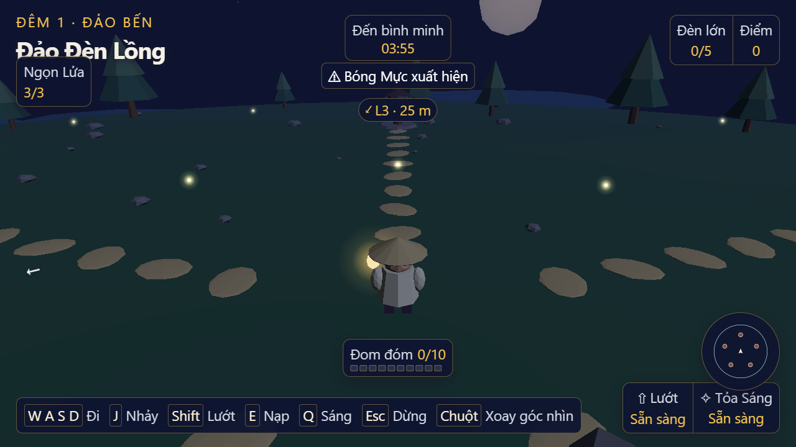

# Đảo Đèn Lồng

[Video demo MP4](docs/demo/demo.mp4) · [Release v1.0.0](https://github.com/Namtran1203/K5-L3A-DAY12-TranThanhNam-2A202603564-AI-SDLC/releases/tag/v1.0.0) · [Bằng chứng Phase 4](docs/proof/phase-4/README.md)

Mây, người giữ đèn nhỏ tuổi, gom đom đóm để thắp lại Đảo Bến, Đảo Cau và Đảo Chuông trước bình minh. Dùng đèn sáng làm nơi trú Bóng Mực, vượt cầu tre và tận dụng bục nhảy trên hành trình qua ba đêm.



[Bằng chứng Phase 3](docs/proof/phase-3/README.md) · [Bằng chứng Phase 2](docs/proof/phase-2/README.md) · [Bằng chứng Phase 1](docs/proof/phase-1/README.md) · [Tài liệu lab](LAB.md)

## Chạy game

Cần Node.js 22 trở lên và trình duyệt hỗ trợ WebGL 2 trên macOS, Linux hoặc Windows. Sau khi clone repo, chạy hai lệnh sau và mở `http://127.0.0.1:4173`.

```sh
npm ci
npm start
```

| Điều khiển | Tác dụng |
|---|---|
| WASD hoặc phím mũi tên | Đi theo hướng camera |
| Space | Nhảy |
| Shift | Lướt theo hướng chạy hoặc hướng Mây đang quay mặt |
| E | Nạp đom đóm vào đèn đã tắt gần Mây nhất |
| Q | Tiêu 3 đom đóm để Tỏa Sáng, làm choáng Bóng Mực và xua Gió Lạc đang đuổi |
| Esc hoặc P | Tạm dừng hoặc tiếp tục |
| Kéo chuột trên cảnh 3D | Xoay camera |

Mỗi đèn cần 10 đom đóm để thắp lần đầu và 5 để thắp lại. Dầu cạn dần và mỗi đom đóm châm thêm 10 dầu. Từ 30 dầu trở lên, đèn tạo vùng an toàn bán kính 6 m. Bóng Mực có thể hút dầu ở đèn yếu. Mây bắt đầu với 3 Ngọn Lửa và sức chứa 10, tăng 2 sau mỗi lần thắp thành công tới tối đa 20. Gió Lạc vẫn có thể cướp ánh sáng ở vùng an toàn. Bùa Gió tăng tốc và bỏ hồi chiêu Lướt.

Bước ra khỏi mép đảo có thể làm Mây mất một Ngọn Lửa và toàn bộ đom đóm đang mang. Đêm 2 có cầu tre và bục phóng qua đảo kia. Đêm 3 có hai dốc lên tầng trên, một bục phóng lên tháp chuông và gió mạnh được báo bằng lá bay, phụ đề và âm thanh. Cài đặt lưu phím, âm lượng, độ nhạy chuột, bảng màu, giảm chuyển động và chữ lớn. Khi giảm chuyển động, cảnh báo hình ảnh vẫn hiển thị.

## Điểm số

Giữ lần lượt 3/5, 4/6 và 5/7 đèn sáng tới bình minh và sống sót để qua Đêm. Nạp hoặc châm một đom đóm được 5 điểm, thắp lần đầu 100 điểm và thắp lại 40 điểm. Tỏa Sáng được 15 điểm cho mỗi Bóng Mực đang hút dầu trúng đòn, hoặc 5 điểm cho mỗi con khác. Khi thắng, mỗi đèn sáng cộng 50 điểm cộng phần nguyên lượng dầu còn lại, và mỗi Ngọn Lửa cộng 50 điểm. Màn Bình Minh hiển thị tổng điểm ba đêm đã thắng.

## Kiểm chứng và headless

```sh
npm run verify
node src/headless.mjs --seed 2026 --night 1 --ticks 60 --scenario docs/proof/phase-3/oil-scenario.json --inputs docs/proof/phase-3/oil-inputs.json --out night-one.jsonl
```

Contract và toàn bộ thông số khai báo trong [game.contract.json](game.contract.json). CLI nhận `--night 1`, `2` hoặc `3` và tùy chọn `--scenario <file.json>`. Nếu bỏ `--inputs`, người chơi không bấm phím. Nếu bỏ `--snapshot-every`, CLI ghi snapshot mỗi 10 tick, bắt đầu từ tick 0. Game trên web và headless chạy cùng mô phỏng 60 tick/giây. Khi tạm dừng, chỉ `tick` tiếp tục tăng. Các bộ đếm gameplay đi theo `sim_tick`.

Các đối tượng `drifters` trong scenario có `pos` và các trường tùy chọn `id`, `state`, `state_ticks_left`, `stolen`. Mỗi đối tượng `charms` có `pos` và các trường tùy chọn `id`, `available`, `respawn_ticks`. Tuning `score.per_mote` là điểm cho **mỗi đom đóm nạp**. Đom đóm nhặt lên chưa tính điểm.

## Benchmark và soak

```sh
node scripts/benchmark.mjs --seed 42 --duration 30 --out bench.json
node --expose-gc --max-semi-space-size=1 scripts/soak.mjs --seed 7 --nights 10 --out soak.json
```

Benchmark mở Chromium, Chrome hoặc Edge trong cửa sổ 1280×720. Cần phiên desktop và trình duyệt có WebGL 2. Nếu cần, đặt `CHROME_BIN` tới tệp thực thi hoặc cài Chromium bằng `npx playwright-core install chromium`. Launcher tắt giới hạn khung và đồng bộ GPU bằng cờ Chromium. JSON ghi `peak_mem_mb: null` vì bản web dùng nhiều tiến trình Chromium và launcher không lấy RSS đỉnh thống nhất trên ba hệ điều hành. Soak đo RSS cùng tiến trình Node bằng MiB ở hai mốc đã quy định. Các Đêm dùng seed gốc cộng chỉ số từ 0 và luân phiên bản đồ 1 → 2 → 3.

## Bảng xếp hạng và bản phát hành

Sau Bình Minh hoặc khi thua, lưu tên 3–12 ký tự A–Z, a–z, 0–9 hoặc _. Điểm tính từ các Đêm đã thắng. Bản chạy bằng Node lưu điểm vào thư mục dữ liệu của người dùng. Đặt `LANTERN_LEADERBOARD` để chỉ định một tệp dữ liệu riêng khi thử.

```sh
node scripts/serve.mjs --export-leaderboard scores.json
```

Tải **Dao-Den-Long-v1.0.0.zip** từ Release, giải nén rồi chạy `node scripts/serve.mjs` trong thư mục đó bằng Node.js 22+. Gói có sẵn mã web và Three.js. Có thể phục vụ thư mục này ở gốc máy chủ tĩnh, khi đó điểm được lưu trong trình duyệt.

Xem [retro](docs/RETRO.md), [hướng dẫn cho agent](AGENTS.md), [nguồn tài sản](CREDITS.md) và [giấy phép](LICENSE).

## Sáng tạo của tôi

Minimap la bàn đánh dấu vị trí và hướng nhìn của Mây, cầu hoặc tầng cao, cùng các đèn đã sáng. Quầng ấm quanh đèn báo nơi trú Bóng Mực. Minimap, nhạc và màu sắc là một phần của lớp hiển thị. [Ảnh Đảo Cau](docs/proof/phase-2/night-2.png) · [JSONL dầu và bình minh](docs/proof/phase-3/oil-dawn.jsonl)
